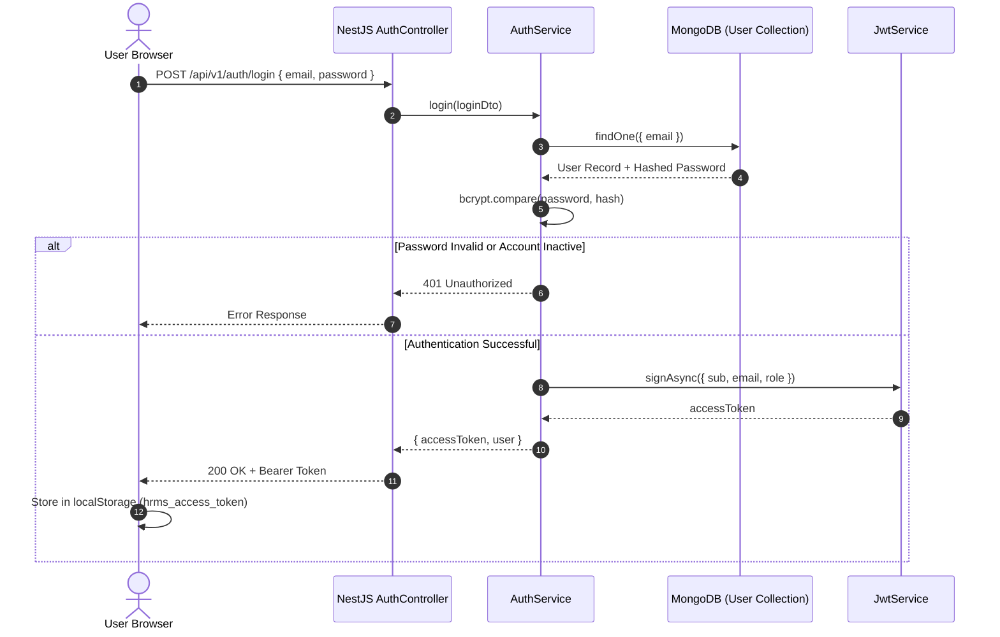
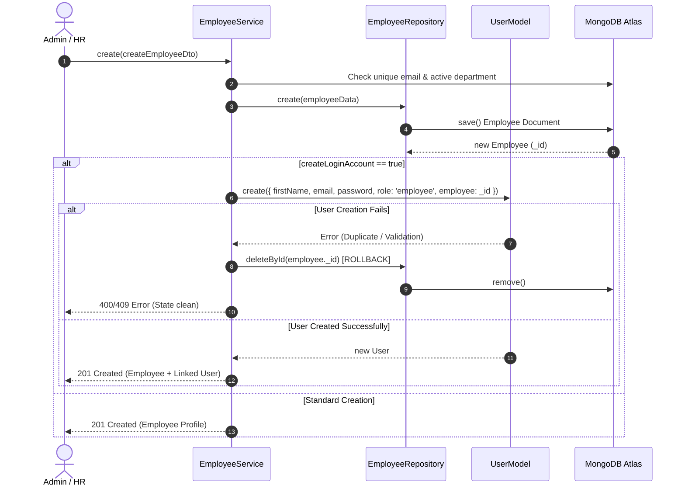
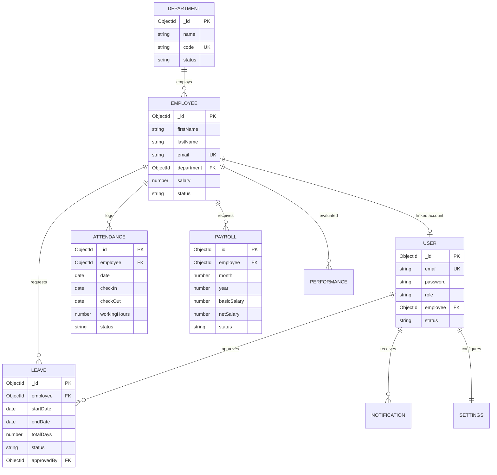

# Enterprise Human Resource Management System (HRMS)

[](https://nestjs.com/)
[](https://react.dev/)
[](https://vitejs.dev/)
[](https://tailwindcss.com/)
[](https://www.mongodb.com/)
[](https://cloudinary.com/)
[](LICENSE)

An enterprise-ready, modular Human Resource Management System designed to handle complete employee lifecycle operations, department organization, daily biometric attendance tracking, leave requests and approvals, multi-tier payroll calculations, performance appraisals, cloud document storage, and analytical reporting.

---

## Table of Contents

- [1. Project Overview](#1-project-overview)
- [2. System Architecture](#2-system-architecture)
- [3. Key Features](#3-key-features)
- [4. Technology Stack](#4-technology-stack)
- [5. Role-Based Access Control (RBAC)](#5-role-based-access-control-rbac)
- [6. Architecture & Data Flow Diagrams](#6-architecture--data-flow-diagrams)
- [7. Complete Folder Structure](#7-complete-folder-structure)
- [8. API Reference Summary](#8-api-reference-summary)
- [9. Database Architecture & Collections](#9-database-architecture--collections)
- [10. Environment Variables Setup](#10-environment-variables-setup)
- [11. Installation & Getting Started](#11-installation--getting-started)
- [12. Testing & Quality Assurance](#12-testing--quality-assurance)
- [13. Security Implementation](#13-security-implementation)
- [14. Detailed Documentation Index](#14-detailed-documentation-index)
- [15. Authors & Maintainers](#15-authors--maintainers)

---

## 1. Project Overview

The **Enterprise HRMS** platform eliminates manual administrative overhead by centralizing workforce records into a secure, responsive single-page application backed by a scalable TypeScript REST API.

### Core Objectives:
- **Centralized Employee Records:** Single source of truth for personal, department, and salary profiles.
- **Role-Based Dynamic UX:** Tailored interfaces for `admin`, `hr`, and `employee` personas.
- **Accurate Work-Time Tracking:** Clock-in/out logs with automated working-hour computation.
- **Conflict-Free Leave Management:** Overlap verification, hierarchical approvals, and email notifications.
- **Automated Payroll Ledger:** Gross/net salary calculations with allowance and deduction tracking.
- **Digital Document Archival:** Direct-to-cloud PDF/image document vault powered by Cloudinary.
- **Executive Reporting:** Instant export of tabular and analytical reports to Excel (XLSX) and PDF.

---

## 2. System Architecture

The solution uses a decoupled **Client-Server Architecture**:

```
+-------------------------------------------------------------------------+
|                        Frontend Client (React 19)                       |
|   Tailwind CSS 4 | Lucide Icons | Sonner Toasts | Recharts | Vite 8     |
+------------------------------------+------------------------------------+
                                     |
                                     | HTTPS / JSON (Bearer JWT)
                                     v
+------------------------------------+------------------------------------+
|                      NestJS 12 API Gateway / Server                      |
|            Global Prefix: /api/v1 | ValidationPipe (Whitelist)          |
+------------------------------------+------------------------------------+
       |                             |                             |
       v                             v                             v
+---------------+             +---------------+             +-------------+
| Authentication|             | Business Logic|             | Cloud/Media |
| Passport JWT  |             | Repositories  |             | Cloudinary  |
| Roles Guard   |             | Mongoose ODM  |             | Nodemailer  |
+-------+-------+             +-------+-------+             +------+------+
        |                             |                            |
        +-----------------------------+----------------------------+
                                      |
                                      v
                      +-------------------------------+
                      |     MongoDB Atlas Cluster     |
                      |  10 Indexed Schema Collections|
                      +-------------------------------+
```

---

## 3. Key Features

### Employee Management
- Complete onboarding with automatic login account provisioning.
- Transactional rollback: guarantees employee record cleanup if linked login creation fails.
- Profile photo uploads and contact management.
- Activation and deactivation state controls.

### Department Administration
- Unique department codes with automatic uppercase normalization.
- Active/inactive status filters and head of department assignment.

### Attendance Tracking
- Daily check-in and check-out recording.
- Automatic daily working-hours computation in hours (decimal).
- Single attendance record enforcement per employee per calendar date.
- Real-time attendance summary counters (Present, Absent, Half-Day, Leave).

### Leave Management
- Overlap detection preventing overlapping active leave requests for an employee.
- Dynamic duration calculation (`totalDays`) factoring UTC boundary dates.
- Manager approvals/rejections with optional audit remarks.
- Automated email dispatch on approval/rejection events.

### Payroll Engine
- Basic salary, allowances, and deductions tracking.
- Strict validation ensuring deductions do not exceed gross earnings.
- Compound unique indexing (`employee + month + year`) preventing duplicate payslips.
- Payment transition workflow: `pending` -> `paid` (with timestamp) or `cancelled`.

### Performance Reviews
- Year-based review records with rating scale (1 - 5 stars).
- Structured goals, achievements, strengths, weaknesses, and manager remarks.

### Secure Cloud Documents
- Cloudinary stream integration supporting PDF, PNG, and JPEG up to 5MB.
- Categorized employee documents with download and preview capability.

### Export & Reporting
- Multi-filter reports across Employees, Attendance, Leaves, Payroll, and Performance.
- Client-side export to formatted Excel (`.xlsx`) and paginated PDF (`.pdf`).

---

## 4. Technology Stack

| Layer | Technologies |
| :--- | :--- |
| **Frontend Framework** | React 19.2.8, Vite 8.3.0 |
| **Frontend Styling** | Tailwind CSS 4.3.3 (`@tailwindcss/vite`) |
| **Routing & Navigation** | React Router DOM 7.18.4 |
| **Data Viz & Export** | Recharts 3.10.1, jsPDF 4.2.1, jsPDF-AutoTable 5.0.8, SheetJS XLSX 0.18.5 |
| **Toast Notifications** | Sonner 2.0.8 |
| **Backend Framework** | NestJS 12.0.1, Express, TypeScript 6.0.2 |
| **Authentication** | Passport.js 0.7.0, Passport JWT 4.0.1, bcrypt 6.0.0 |
| **Database & ODM** | MongoDB Atlas, Mongoose 9.10.3, `@nestjs/mongoose` 12.0.0 |
| **Validation** | `class-validator` 0.15.1, `class-transformer` 0.5.1 |
| **Cloud Storage** | Cloudinary SDK 2.11.0, Multer 2.4.0 |
| **Mail Transport** | Nodemailer 10.0.15, Pug 3.0.4 |

---

## 5. Role-Based Access Control (RBAC)

The application enforces strict authorization across both client and server:

| Feature / Resource | Employee | HR Manager | Administrator |
| :--- | :---: | :---: | :---: |
| Self Dashboard & Profile | Read / Update | Read / Update | Read / Update |
| Personal Attendance / Leaves | Read / Submit | Read / Submit | Read / Submit |
| Personal Payslips & Documents | Read | Read | Read |
| Employee Directory Management | Read Only | Full CRUD | Full CRUD |
| Department Administration | Read Only | Full CRUD | Full CRUD |
| Company Attendance Records | No Access | Full CRUD | Full CRUD |
| Leave Approvals / Rejections | No Access | Approve / Reject | Approve / Reject |
| Payroll Processing & Payouts | No Access | Process / Pay | Process / Pay |
| Performance Appraisals | Read Only | Create / Edit | Create / Edit / Delete |
| User Account Management | No Access | Read Only | Full CRUD |
| System Configuration | No Access | No Access | Read / Update |

---

## 6. Architecture & Data Flow Diagrams

### 6.1 Authentication Workflow



### 6.2 Employee Creation & Transactional Rollback



### 6.3 Database Entity Relationship Map



---

## 7. Complete Folder Structure

```
EmpManagement/
├── .gitignore                    # Master root Git ignore rules
├── LICENSE                       # Project License
├── README.md                     # Master Technical Documentation
├── docs/                         # Detailed Architecture & Module Docs
│   ├── PROJECT_OVERVIEW.md       # High-level goals & executive breakdown
│   ├── FRONTEND_DOCUMENTATION.md # React, Vite, Pages, Routing & Services
│   ├── BACKEND_DOCUMENTATION.md  # NestJS, DTOs, Controllers & Services
│   ├── DATABASE_DOCUMENTATION.md # Collections, Fields, Types & Indexes
│   ├── API_DOCUMENTATION.md      # Full REST API Reference
│   ├── AUTHENTICATION_FLOW.md    # Auth lifecycle, Tokens, Reset passwords
│   ├── PROJECT_ARCHITECTURE.md   # Architectural patterns & system designs
│   ├── SETUP_GUIDE.md            # Step-by-step dev and prod setup guide
│   └── DEVELOPMENT_GUIDELINES.md # Standards, conventions & PR workflows
├── backend/                      # NestJS 12 TypeScript API Server
│   ├── .env.example              # Environment variables template
│   ├── .gitignore                # Backend specific ignores
│   ├── nest-cli.json             # Nest CLI configuration
│   ├── package.json              # Backend dependencies and scripts
│   ├── tsconfig.json             # TypeScript compiler settings
│   └── src/
│       ├── app.module.ts         # Root AppModule
│       ├── main.ts               # Application bootstrap
│       ├── attendance/           # Daily biometric attendance module
│       ├── auth/                 # JWT Auth, Passport strategy, Guards
│       ├── common/               # Shared Cloudinary and Email services
│       ├── dashboard/            # Analytical aggregation repository
│       ├── department/           # Corporate departments module
│       ├── document/             # Cloudinary cloud document storage
│       ├── employee/             # Core employee directory module
│       ├── leave/                # Leave application & approval engine
│       ├── notification/         # In-app alert dispatching module
│       ├── payroll/              # Salary disbursement ledger
│       ├── performance/          # Performance review & rating engine
│       ├── report/               # Multi-collection report service
│       ├── settings/             # User alert configurations
│       └── user/                 # User management & security profiles
└── frontend/                     # React 19 Single Page Application
    ├── .env.example              # Frontend environment template
    ├── .gitignore                # Frontend specific ignores
    ├── index.html                # HTML5 root template
    ├── package.json              # Frontend dependencies and scripts
    ├── vite.config.js            # Vite build and Tailwind configuration
    └── src/
        ├── App.jsx               # Application root provider
        ├── main.jsx              # React DOM bootstrap
        ├── index.css             # Tailwind CSS entry directives
        ├── assets/               # Logos, hero images, vectors
        ├── components/           # Reusable widgets, Sidebar, Navbar
        ├── context/              # AuthContext & persistent state
        ├── layouts/              # DashboardLayout wrapper
        ├── pages/                # 34 modular view pages
        ├── routes/               # AppRoutes & ProtectedRoute guards
        ├── services/             # 13 REST API client integration modules
        └── utils/                # PDF & XLSX document generator
```

---

## 8. API Reference Summary

All API endpoints are prefixed with `/api/v1` and return standard JSON responses:

```json
{
  "success": true,
  "message": "Operation completed successfully",
  "data": { ... }
}
```

| Module | Method | Endpoint | Access | Purpose |
| :--- | :---: | :--- | :--- | :--- |
| **Auth** | `POST` | `/api/v1/auth/login` | Public | Authenticates user and returns JWT token |
| **Auth** | `POST` | `/api/v1/auth/register` | Public | Self-registration endpoint |
| **Auth** | `POST` | `/api/v1/auth/forgot-password` | Public | Generates 1-hour reset token and sends email |
| **Auth** | `POST` | `/api/v1/auth/reset-password` | Public | Resets password with valid token |
| **Auth** | `POST` | `/api/v1/auth/change-password` | Authenticated | Updates authenticated user password |
| **Employees** | `GET` | `/api/v1/employees` | All Roles | Lists all employees |
| **Employees** | `POST` | `/api/v1/employees` | Admin, HR | Creates employee & optional user account |
| **Employees** | `GET` | `/api/v1/employees/me/profile`| All Roles | Retrieves personal profile record |
| **Employees** | `PATCH`| `/api/v1/employees/:id` | Admin, HR | Updates employee profile |
| **Employees** | `DELETE`| `/api/v1/employees/:id` | Admin | Soft-deactivates employee |
| **Departments**| `GET` | `/api/v1/departments` | All Roles | Lists active/inactive departments |
| **Departments**| `POST`| `/api/v1/departments` | Admin, HR | Adds department with unique uppercase code |
| **Attendance** | `GET` | `/api/v1/attendance` | All Roles | Filters records by date, employee, status |
| **Attendance** | `POST`| `/api/v1/attendance` | Admin, HR | Logs attendance & calculates working hours |
| **Attendance** | `GET` | `/api/v1/attendance/summary` | Admin, HR | Today's aggregate present/absent counters |
| **Leaves** | `GET` | `/api/v1/leaves` | All Roles | Lists leaves (filterable by status/employee)|
| **Leaves** | `POST`| `/api/v1/leaves` | All Roles | Submits leave request with overlap check |
| **Leaves** | `PATCH`| `/api/v1/leaves/:id/approve` | Admin, HR | Approves leave and dispatches notification |
| **Leaves** | `PATCH`| `/api/v1/leaves/:id/reject` | Admin, HR | Rejects leave with optional remarks |
| **Payroll** | `GET` | `/api/v1/payroll` | All Roles | Query paginated payroll records |
| **Payroll** | `POST`| `/api/v1/payroll` | Admin, HR | Generates month/year payslip ledger |
| **Payroll** | `PATCH`| `/api/v1/payroll/:id/pay` | Admin, HR | Marks salary record as paid with timestamp |
| **Documents** | `POST`| `/api/v1/documents/upload` | Admin, HR | Streams multipart file to Cloudinary |
| **Reports** | `GET` | `/api/v1/reports/summary` | Admin, HR | Executive company metrics summary |

*See [docs/API_DOCUMENTATION.md](docs/API_DOCUMENTATION.md) for full request/response schemas.*

---

## 9. Database Architecture & Collections

The MongoDB database (`employees-db`) organizes business records across 10 collections:
1. **`users`**: Authentication credentials, roles (`admin`, `hr`, `employee`), and password recovery tokens.
2. **`employees`**: Employee master records linked to a Department.
3. **`departments`**: Company divisions with unique uppercase codes.
4. **`attendances`**: Daily presence records with check-in, check-out, and auto-computed working hours.
5. **`leaves`**: Vacation/sick leave requests with status flags and approval timestamps.
6. **`payrolls`**: Monthly compensation records with allowances, deductions, and gross/net values.
7. **`performances`**: Annual evaluation reviews with numerical ratings (1-5) and feedback.
8. **`documents`**: Cloudinary URLs, public IDs, and metadata for employee files.
9. **`notifications`**: Targeted user alerts with read/unread tracking.
10. **`settings`**: User-specific notification preference toggles.

---

## 10. Environment Variables Setup

### Backend Configuration (`backend/.env`)
Copy `backend/.env.example` to `backend/.env` and update the parameters:

```env
PORT=5002
MONGODB_URI=mongodb+srv://<username>:<password>@cluster.mongodb.net/employees-db?retryWrites=true&w=majority
JWT_SECRET=super_secret_jwt_key_at_least_32_characters
JWT_EXPIRES_IN=7d
CLOUDINARY_CLOUD_NAME=your_cloud_name
CLOUDINARY_API_KEY=your_api_key
CLOUDINARY_API_SECRET=your_api_secret
SMTP_HOST=smtp.mailtrap.io
SMTP_PORT=587
SMTP_USER=your_smtp_user
SMTP_PASS=your_smtp_password
FRONTEND_URL=http://localhost:5173
```

### Frontend Configuration (`frontend/.env`)
Copy `frontend/.env.example` to `frontend/.env`:

```env
VITE_API_BASE_URL=http://localhost:5002/api/v1
```

---

## 11. Installation & Getting Started

### Prerequisites
- **Node.js:** v18.0.0 or higher (v20+ recommended)
- **npm:** v9.0.0 or higher
- **MongoDB:** Active Atlas cluster or local MongoDB 6+ daemon

### 1. Clone the Repository
```bash
git clone https://github.com/harshshaah/hrms-enterprise-system.git
cd hrms-enterprise-system
```

### 2. Backend Setup
```bash
cd backend
npm install
cp .env.example .env
# Edit .env with your MongoDB and Cloudinary credentials
npm run build
npm run start:dev
```
The NestJS server will start on `http://localhost:5002/api/v1`.

### 3. Frontend Setup
Open a separate terminal:
```bash
cd frontend
npm install
cp .env.example .env
npm run dev
```
The Vite development server will start on `http://localhost:5173`.

---

## 12. Testing & Quality Assurance

### Backend Unit & Integration Tests
```bash
cd backend
npm run test          # Run Vitest test suites
npm run test:cov      # Run coverage report
npm run test:e2e      # Run end-to-end integration tests
npm run lint          # Run fast Oxlint static analysis
```

### Frontend Build Verification
```bash
cd frontend
npm run lint          # Run ESLint 10 checks
npm run build         # Production bundling verification
```

---

## 13. Security Implementation

- **No Plaintext Passwords:** Hashed with salted `bcrypt` (10 rounds).
- **Zero Secrets in Version Control:** All `.env` files are ignored by both root and submodule `.gitignore` configurations.
- **Strict DTO Validation:** Injections and unexpected fields are blocked via NestJS `ValidationPipe` with `{ whitelist: true, forbidNonWhitelisted: true }`.
- **RBAC Server Guards:** Endpoints protected by Passport JWT and `RolesGuard` backed by custom `@Roles()` metadata.
- **Sanitized Uploads:** Cloudinary file uploads enforce 5MB limits and MIME-type restrictions (PDF, PNG, JPG).
- **Auto-Logout on Expiry:** The frontend intercepts `401 Unauthorized` responses, clears tokens, and redirects safely to the login screen.

---

## 14. Detailed Documentation Index

For exhaustive technical specifications, navigate to the dedicated [`docs/`](docs/) directory:

- [System Architecture](docs/PROJECT_ARCHITECTURE.md) - Deep architectural patterns and request flows.
- [Project Overview](docs/PROJECT_OVERVIEW.md) - Business requirements, personas, and roadmap.
- [Frontend Documentation](docs/FRONTEND_DOCUMENTATION.md) - React component tree, routing, and context.
- [Backend Documentation](docs/BACKEND_DOCUMENTATION.md) - NestJS modules, controllers, and services.
- [Database Documentation](docs/DATABASE_DOCUMENTATION.md) - Full schemas, field types, and relationships.
- [API Documentation](docs/API_DOCUMENTATION.md) - Complete endpoints, parameters, and payloads.
- [Authentication Flow](docs/AUTHENTICATION_FLOW.md) - JWT lifecycle, guard evaluation, and password resets.
- [Setup & Deployment Guide](docs/SETUP_GUIDE.md) - Local, Docker, and cloud deployment runbooks.
- [Development Guidelines](docs/DEVELOPMENT_GUIDELINES.md) - Coding standards, Git flow, and commit rules.

---

## 15. Authors & Maintainers

- **Lead Developer & Architect:** [harshshaah](https://github.com/harshshaah)
- **Organization:** Enterprise Solutions Group
- **Repository:** [`https://github.com/harshshaah/hrms-enterprise-system`](https://github.com/harshshaah/hrms-enterprise-system)

