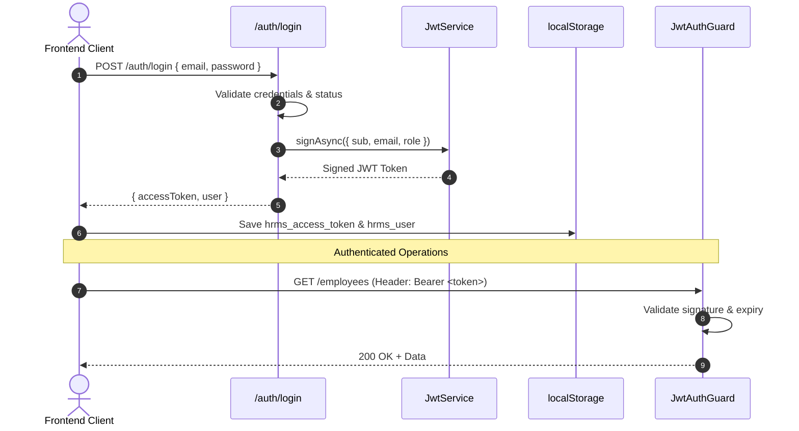
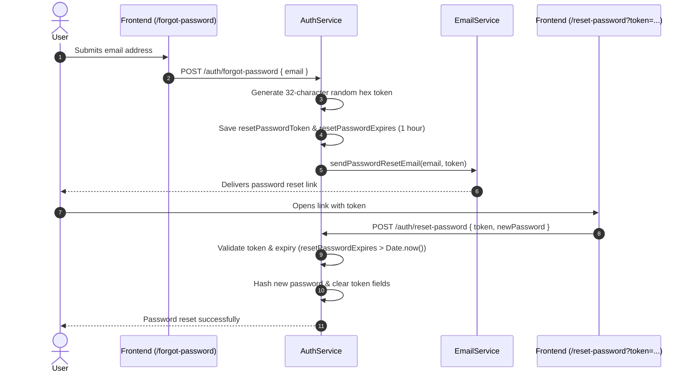

# Authentication & Authorization Flow

## 1. Authentication Lifecycle

The application implements a stateless **JSON Web Token (JWT)** architecture using NestJS Passport.



---

## 2. Token Details & Payload

- **Token Type:** JSON Web Token (Bearer)
- **Algorithm:** HMAC SHA-256 (`HS256`)
- **Default Lifetime:** 7 days (`JWT_EXPIRES_IN=7d`)
- **Payload Structure:**
  ```json
  {
    "sub": "6743fc1234567890abcdef12",
    "email": "user@example.com",
    "role": "admin",
    "iat": 1732512000,
    "exp": 1733116800
  }
  ```

---

## 3. Password Hashing & Encryption

- **Algorithm:** `bcrypt` with work factor 10.
- Password hashes are stored in the `password` field of the `users` collection.
- Passwords are automatically excluded from query results using `.select('-password')` in User queries.

---

## 4. Password Recovery Workflow



---

## 5. Role-Based Access Control (RBAC)

### 5.1 System Roles
1. **`admin`**: Super-administrator. Complete CRUD across all collections including Users and Settings.
2. **`hr`**: Human Resource Operations. Full management across Employees, Departments, Attendance, Leaves, Payroll, Documents, and Reports.
3. **`employee`**: Individual contributor. Restricted to self-service endpoints (`/me/profile`, `/my-attendance`, `/my-leaves`, `/my-payroll`, `/my-documents`).

### 5.2 Server Guard Architecture
Every protected route passes through two sequential guards:
```typescript
@UseGuards(JwtAuthGuard, RolesGuard)
```
1. **`JwtAuthGuard`**: Ensures token validity and attaches payload to `request.user`.
2. **`RolesGuard`**: Reads `@Roles('admin', 'hr')` metadata via NestJS `Reflector`. Rejects non-conforming requests with `403 ForbiddenException`.

