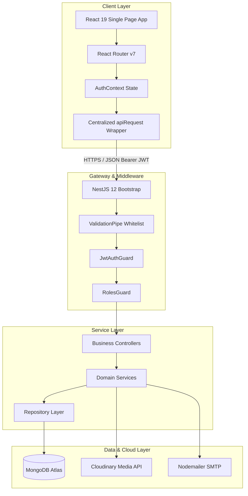

# System Architecture & Technical Design

## 1. High-Level Architecture Overview

Enterprise HRMS is built around a decoupled **Client-Server Architecture** adhering to clean code and domain separation principles:



---

## 2. Design Patterns Implemented

### 2.1 Repository Pattern
Domain services do not interact with Mongoose models directly for complex domains (such as `Employee`, `Attendance`, `Leave`, `Payroll`, and `Performance`). Instead, dedicated repositories encapsulate database queries, projection pipelines, and pagination logic:
- `EmployeeRepository`: CRUD and email lookup.
- `AttendanceRepository`: Filtered range queries, daily summary aggregations.
- `LeaveRepository`: Date-overlap checks, employee leave history.
- `PayrollRepository`: Duplicate prevention, month/year filtering, payout status toggles.
- `PerformanceRepository`: Appraisals queries, rating aggregations.

### 2.2 Global DTO Validation (Data Transfer Objects)
All incoming payloads are strictly validated using `class-validator` and `class-transformer`:
```typescript
app.useGlobalPipes(
  new ValidationPipe({
    whitelist: true,              // Strips non-decorated properties
    transform: true,              // Automatically coerces types
    forbidNonWhitelisted: true,   // Rejects unexpected properties
  }),
);
```

### 2.3 Layered Client-Side Architecture
- **Views (`src/pages/`):** Pure presentation and user interaction orchestration.
- **Components (`src/components/`):** Stateless, reusable UI widgets (Statcard, Sidebar, Navbar).
- **Service Layer (`src/services/`):** Isolated fetch operations abstracting HTTP endpoints from view logic.
- **Utilities (`src/utils/`):** Reusable non-UI logic (e.g. `ReportGenerator.js` for XLSX/PDF generation).

---

## 3. Communication Protocols

| Interface | Protocol | Format | Security |
| :--- | :--- | :--- | :--- |
| Client &harr; Server | HTTPS / REST | JSON | Bearer JWT Token |
| Server &harr; MongoDB | Native MongoDB Wire Protocol | BSON | TLS 1.3, SCRAM-SHA-256 |
| Server &harr; Cloudinary | HTTPS / REST Multipart | Binary Stream | API Key + Signature Hash |
| Server &harr; SMTP Server | SMTP / STARTTLS | MIME HTML | User/Pass Credentials |

